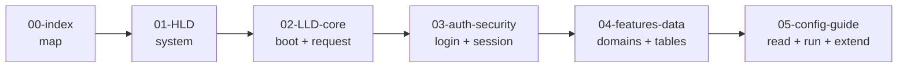
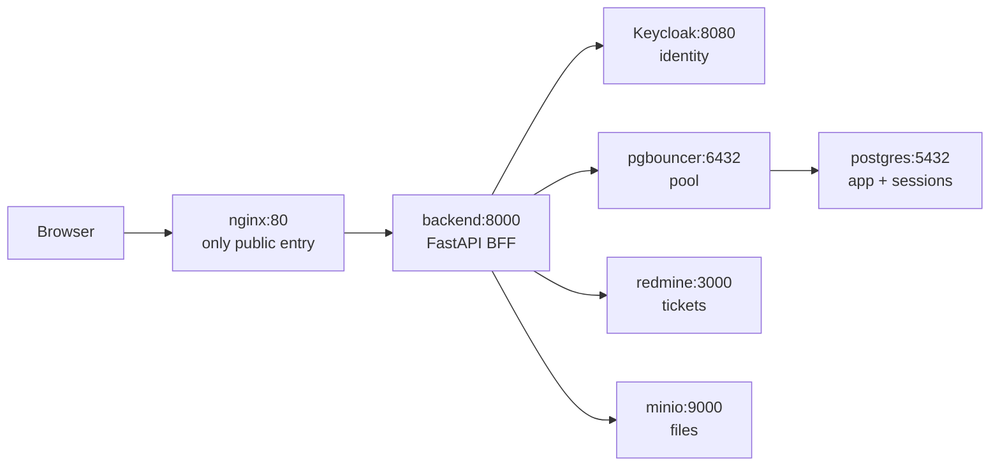

# Backend Docs — Start Here

Read in order. Each doc answers one question without inspecting every file.

| # | Doc | Question it answers |
|---|-----|---------------------|
| 00 | `00-index.md` (this file) | Where do I start? |
| 01 | `01-hld.md` | What is the system? Services, network, request flow. |
| 02 | `02-lld-core.md` | How does the FastAPI app boot and handle a request? `main.py`, middleware, `core/`. |
| 03 | `03-auth-security.md` | How do login, sessions, rate limits, brute-force protection work? |
| 04 | `04-features-data.md` | What does each feature do? What is the data model? |
| 05 | `05-config-guide.md` | How do I read the codebase, configure it, run it, and add a feature? |

## 30-second mental model

- Backend is a **Backend-for-Frontend**: thin routes, logic in `service.py`, DB via `Depends(get_db)`.
- Identity lives in **Keycloak**; session lives in **`sessions`** table + cookie.
- **Working days = `shifts` rows**, never Mon–Fri. This rule drives attendance, absenteeism, leaves/WFH analytics.
- Source of truth for behavior: `context/` folder. API details: existing `docs/*.md`.

## Where to go next

- New to the system → read `01-hld.md`.
- Debugging a request → read `02-lld-core.md`.
- Login/logout/429/blocked → read `03-auth-security.md`.
- Feature logic or tables → read `04-features-data.md`.
- Env vars, local run, adding an endpoint → read `05-config-guide.md`.
