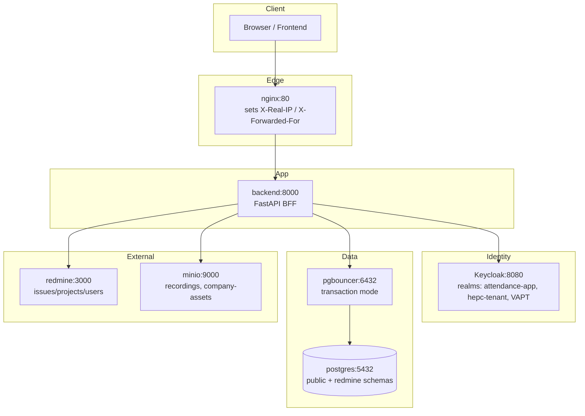
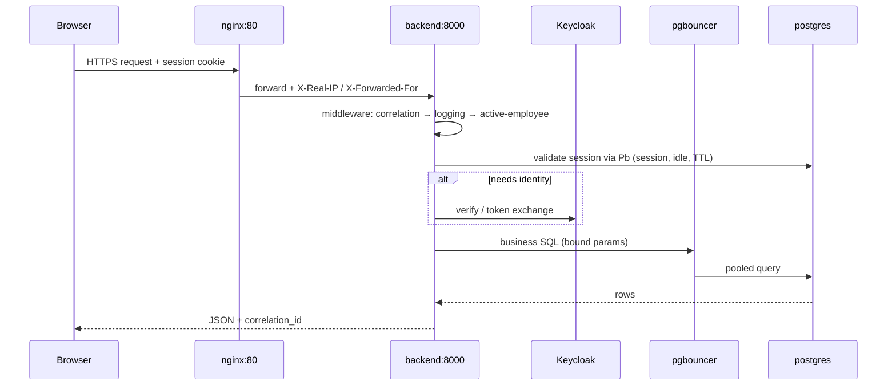

# 01 — HLD: System, Network, Request Flow

Goal: understand the whole system in 5 minutes.

## 1. Stack

| Layer | Tech | Code / config |
|---|---|---|
| API | FastAPI, SQLAlchemy, gunicorn + uvicorn workers | `apps/backend/app/main.py`, `apps/backend/Dockerfile` |
| DB | PostgreSQL via pgbouncer (transaction mode) | `infra/pgbouncer/`, `app/core/database.py` |
| Identity | Keycloak OIDC, multi-realm | `app/core/config.py`, `app/features/auth/` |
| Tickets | Redmine (own local DB) | `REDMINE_URL`, `app/features/redmine/` |
| Edge | nginx — single public entry | `infra/nginx/` |
| Files | MinIO / S3 | `MINIO_*` env |
| Mail | SMTP (opt-in) | `SMTP_*` env |

Entry point: `app.main:app`.

## 2. Services and ports

| Service | Container | Reachable at |
|---|---|---|
| nginx | `infra-nginx-1` | `0.0.0.0:80` (only public entry) |
| backend | `infra-backend-1` | `backend:8000` (internal only, no published port) |
| keycloak | `infra-keycloak-1` | `127.0.0.1:8080` |
| redmine | `infra-redmine-1` | `127.0.0.1:3000` |
| pgbouncer | `infra-pgbouncer-1` | `127.0.0.1:6432` |
| postgres | `backend_postgres` | `192.168.122.101:5432` |

`infra/docker-compose.yml` only includes per-service files under `infra/<svc>/docker-compose.yml`.

## 3. Architecture diagram



## 4. Request flow (API)



Rules:

1. Backend is **only reachable through nginx**. Trust `X-Real-IP` / `X-Forwarded-For` for IP decisions; never trust client-supplied IP headers.
2. pgbouncer is **transaction-pooled**: no session state, pin timezone in SQL (`AT TIME ZONE 'Asia/Kolkata'`), use `NullPool` client-side.
3. Rate limiter store is **in-memory per gunicorn worker** (4 workers) → effective limits ≈ 4× configured.

## 5. Deploy / health

```bash
cd infra
docker compose build backend
docker compose up -d backend
curl -s -o /dev/null -w "%{http_code}\n" http://localhost/health   # expect 200
```

- `GET /` → `{"message":"Backend API","status":"running"}`
- `GET /health` → `{"status":"ok"}` (both limiter-exempt)
- `GET /server-time` → UTC time
- `GET /api/me` → current session user

Next: `02-lld-core.md` — how the app boots and handles one request.
