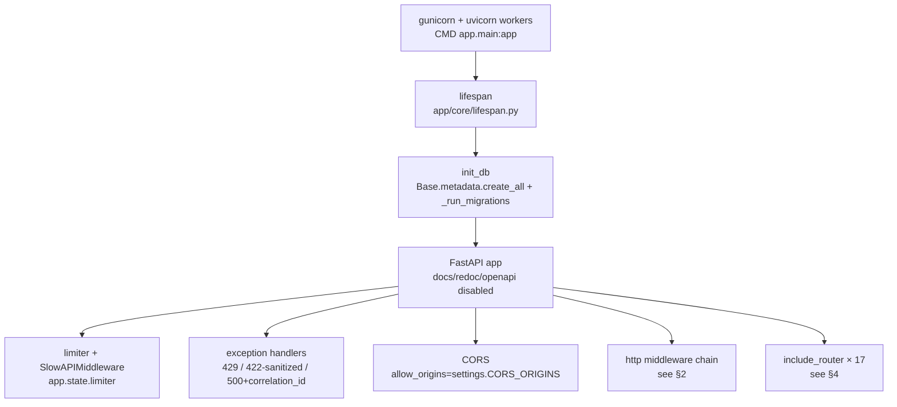
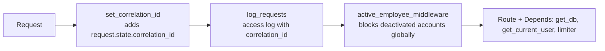
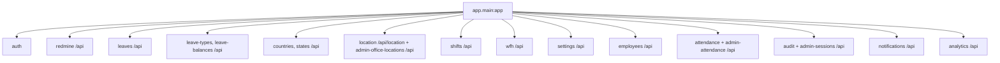
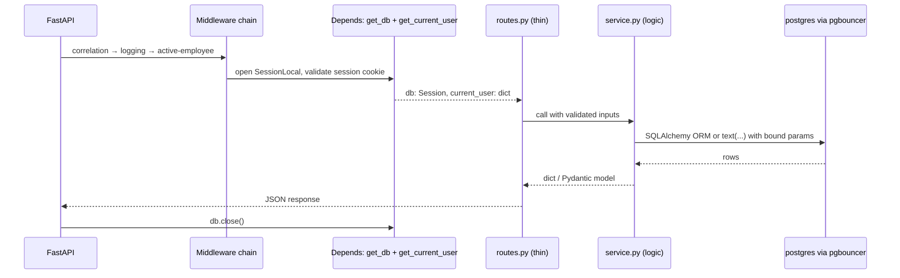

# 02 — LLD Core: Boot, Middleware, Core Modules

Goal: trace one request from boot to response. Files: `apps/backend/app/main.py`, `app/core/*`, `app/middleware/*`.

## 1. Boot sequence

- `lifespan` runs `init_db()` once per worker boot. The attendance sweeper does **not** run here — it is a standalone cron (`scripts/attendance_sweeper.py`) so it executes once per interval.
- `init_db()` does `create_all` plus idempotent `DO $$ ...` migrations in `app/core/database.py` (new columns, indexes, `leave_types`, `notifications`, `states` seed, FK backfills).

## 2. Middleware chain (order matters)

Registered in `main.py` bottom-up. Execution order per request:

| Middleware | File | What it does |
|---|---|---|
| `set_correlation_id` | `app/middleware/correlation.py` | Assigns ID, returned on 500s for log correlation |
| `log_requests` | `app/middleware/logging.py` | Structured request/response log |
| `active_employee_middleware` | `app/middleware/active_employee.py` | Rejects `is_active=false` before any route |
| `origin_validation_middleware` | `app/middleware/csrf.py` | CSRF origin check — currently **commented out** in `main.py` |

## 3. Core modules — what each file owns

| File | Owns |
|---|---|
| `app/core/config.py` | `Settings` (pydantic-settings): env → `.env` → defaults. Computed `JWKS_URL`, `ISSUER_URL`, `TOKEN_URL`, `LOGOUT_URL`. CORS accepts JSON list or comma string. |
| `app/core/database.py` | `engine` (`NullPool` default behind pgbouncer; `queue` only for direct PG), `SessionLocal`, `get_db()` yield/close dependency, `_run_migrations()` |
| `app/core/lifespan.py` | Startup/shutdown hooks |
| `app/core/client_ip.py` | `security_client_ip()`: `X-Real-IP` → leftmost `X-Forwarded-For` → TCP peer. Only safe because nginx is the sole entry. |
| `app/core/limiter.py` | slowapi `limiter`, keyed on real client IP |
| `app/core/logging.py` | `setup_logging()` |
| `app/core/cache.py` | Shared cache helpers |
| `app/core/models.py` | `Base` for ORM models |

## 4. Router registration (`main.py`)

All routers mount under `/api` except auth (own prefixes) and location (`/api/location`):

## 5. Request lifecycle (code path)

Conventions (enforced):

- Routes stay thin; logic in `service.py`. Pydantic models in `schemas.py`, snake_case.
- DB: `Session` via `Depends(get_db)`; raw SQL uses `text(...)` + bound params, never f-string user input.
- Errors: `raise HTTPException` with short `detail`. Validation errors sanitized to `{field, message}`.
- Dates `YYYY-MM-DD`; day boundaries in **IST**. `ORDER BY` deterministic (tiebreak column). Avoid N+1 — batch with `ANY(:ids)`.

Next: `03-auth-security.md` — login, sessions, limits, blocks.
