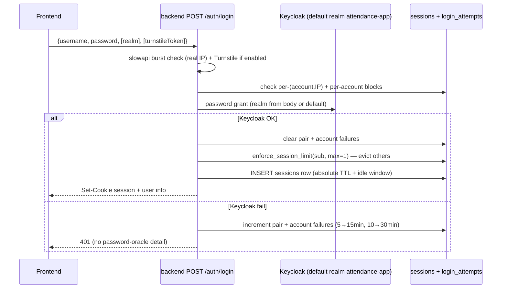
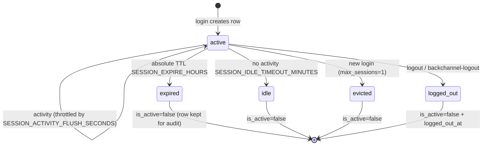
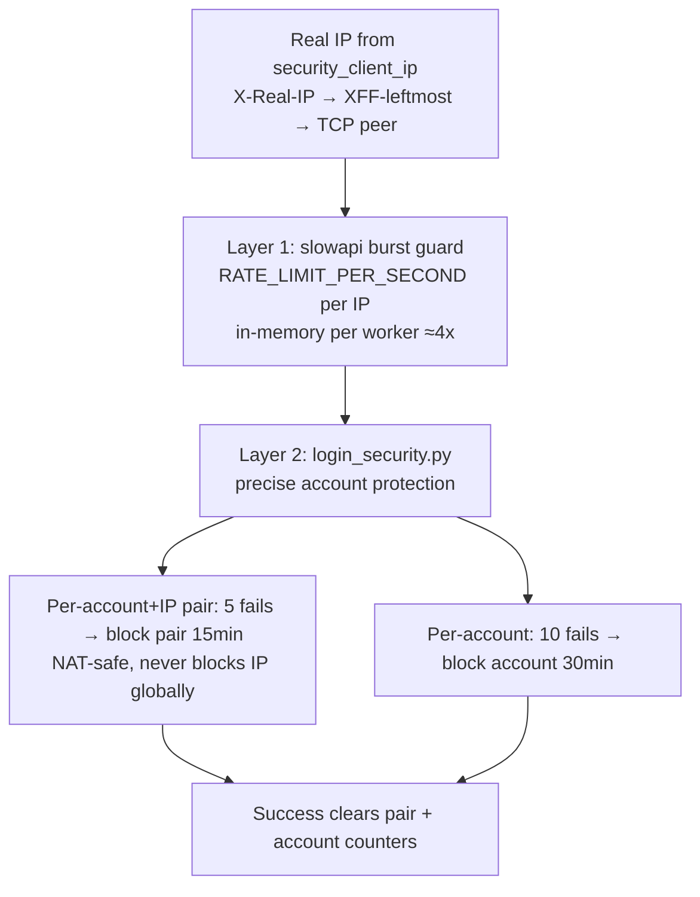

# 03 — Auth, Sessions, Security

Goal: understand login, session enforcement, rate limiting, brute-force blocks. Files: `app/features/auth/*`, `app/utils/login_security.py`, `app/core/client_ip.py`, `app/middleware/active_employee.py`.

## 1. Login flow

- Non-default realms require `"realm": "<name>"` (e.g. `"vapt"`). Realms: `attendance-app` (default), `hepc-tenant`, `VAPT`. Extra realms via `EXTRA_REALMS` JSON.
- `GET /api/me` returns current user via `get_current_user` (session cookie).
- Turnstile: only enforced when **both** `TURNSTILE_ENABLED=true` and `TURNSTILE_SECRET_KEY` set; applies to `/auth/login` and `/auth/forgot-password`.

## 2. Session enforcement

| Setting | Default | Meaning |
|---|---|---|
| `SESSION_EXPIRE_HOURS` | 24 | Absolute lifetime |
| `SESSION_IDLE_TIMEOUT_MINUTES` | 15 | Sliding idle logout |
| `SESSION_ACTIVITY_FLUSH_SECONDS` | 60 | Throttle `last_activity_at` writes |
| `max_sessions` | 1 | New login evicts other sessions — multiple devices/tabs log each other out |

Expiry/idle soft-delete (`is_active=false`); rows kept for audit. Columns: `id, user_sub, data, is_active, expires_at, last_activity_at, logged_out_at, display_id`.

## 3. Rate limiting vs brute-force (two layers)

- IP key comes from `_get_security_ip` (trusted proxy headers). Backend trusts them **only** because nginx is the sole entry with no published backend port.
- Table `login_attempts(identifier, kind, failure_count, blocked_until)`, `kind ∈ ('ip','email')`.
- Successful login clears both counters.

## 4. Related guards

| Guard | Where | Note |
|---|---|---|
| Active-employee block | `app/middleware/active_employee.py` | Runs before any route; deactivated accounts rejected globally |
| Trusted devices | `trusted_device_hashes`, `login_alert_cooldown` | New-device detection, fingerprint + token hash, alert cooldown |
| Password reset | `password_reset.py`, `/reset-password` | Only flow that **syncs Keycloak → Redmine** password. Normal login does not. |
| Keycloak ↔ Redmine passwords | independent | Redmine hash is local `SHA1(salt+SHA1(pw))`. They drift unless reset flow used. |
| Redmine identity | email join | If Keycloak and Redmine emails differ, user gets no projects. |
| Cookie | `SECRET_KEY`, `COOKIE_SECURE` | `True` in production (HTTPS). JWT `ALGORITHM=HS256`. |

## 5. Debug checklist

- `401` on login → check `login_attempts` blocks first, then Keycloak realm/client-secret.
- `429` → slowapi burst (per-worker memory) — check `RATE_LIMIT_PER_SECOND`, worker count.
- "Random logouts" → almost always session-limit=1 eviction or idle 15 min, not a bug.
- Rate limit keyed on proxy IP → nginx `X-Real-IP` missing. Verify nginx sets it.

Next: `04-features-data.md` — domains and tables.
