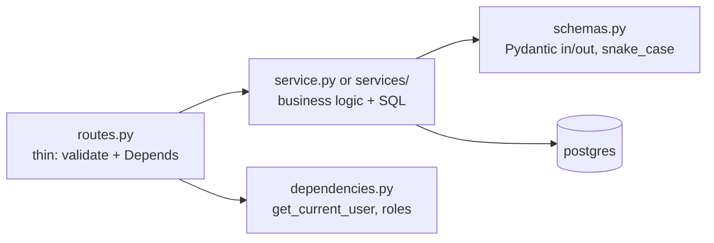
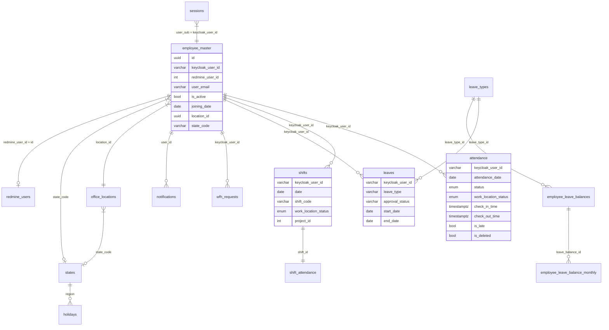

# 04 — Features and Data Model

Goal: know what each domain does and which tables it touches, without reading every file.

## 1. Feature pattern (every feature looks the same)

Location: `apps/backend/app/features/<feature>/`. Features: `auth`, `attendance`, `leaves`, `wfh`, `shifts`, `analytics`, `employees`, `redmine`, `admin`, `audit`, `location`, `notifications`, `settings`, plus `countries.py`, `states/`.

## 2. Domain map

| Feature | Routes | What it does | Key tables |
|---|---|---|---|
| `auth` | login/logout/refresh/reset | Keycloak verify, session row + cookie, device check | `sessions`, `login_attempts`, `trusted_device_hashes` |
| `attendance` (+`admin`) | check-in/out, daily, admin edits | GPS + shift-linked attendance, `shift_attendance` detail | `attendance`, `shift_attendance`, `shifts` |
| `shifts` | roster CRUD | Roster is the source of truth for working days | `shifts` (+`shift_definition`) |
| `leaves` | request/approve, types, balances | Balances by fiscal year + monthly accrual | `leaves`, `leave_types`, `employee_leave_balances`, `employee_leave_balance_monthly` |
| `wfh` | request/approve | Overlap-with-shifts accounting | `wfh_requests` |
| `analytics` | `/api/analytics/*` | Team/member stats (see §4) | reads `shifts`, `attendance`, `leaves`, `wfh_requests`, `holidays`, redmine |
| `employees` | master CRUD, states | Active roster, office/state links | `employee_master`, `office_locations`, `states` |
| `redmine` | tickets/projects/members | BFF over Redmine DB + API | `redmine.users`, `issues`, `projects`, `members` |
| `location` | tracking + admin offices | Geofence check-in, office registry | `office_locations` (`geom`, `radius_meters`, `state_code`) |
| `notifications` | inbox | In-app notifications | `notifications` |
| `settings` | company settings | Branding, reminders, auto-checkout | `system_settings` |
| `audit` / `admin` | audit logs, sessions | Tamper-evident logs, session admin | `audit_logs`, `sessions` |
| `countries` / `states` | geo reference | Holiday scoping by state | `states`, `holidays` |

Shared helpers: `app/utils/` (`audit.py`, `email.py`, `jwt.py`, `login_security.py`, `holiday_scope.py`, `shift_time.py`, `storage.py`, …), `app/services/` (`email_service.py`, `attendance_background_worker.py`).

## 3. ER (app tables + Redmine link)

Enums: `attendance_status = present, absent, half_day, on_leave, holiday`. `work_location = OFFICE, WFH, REMOTE_ONSITE, REMOTE_OFFSITE, LEAVE`. `leaves.approval_status` and `leave_type` are **varchar** (`approved/pending/…`, `EL/CL/SL/CO/UPL/…`). ORM must map `attendance.status` with `SAEnum`, not `String`.

Identity links: `employee_master.keycloak_user_id ↔ Keycloak sub`; `employee_master.redmine_user_id ↔ redmine.users.id`; analytics resolve Redmine user by **email** (`redmine.email_addresses.address`).

## 4. Analytics rules (the one page that prevents bugs)

- **Working days = shifts.** A day counts only if the member has a `shifts` row that day (weekday/weekend/holiday irrelevant). No shift ⇒ not a working day. Dedup with `COUNT(DISTINCT s.date)` — duplicate shift rows exist.
- Scope: **active employees only** (`redmine.users.status=1 AND employee_master.is_active=true`).
- Attendance: `present = status=present`; `wfh = present + work_location=WFH`; `office = present − wfh`; `leave = leave status / LEAVE`; `absent = max(working − present − leave, 0)`; `pct = present/working×100`; `holiday_days` = holidays in range deduped.
- Punctuality: `is_late` flag; avg/earliest/latest check-in in IST.
- Absenteeism: streaks run over **working days** only; red flag streak ≥ 3.
- Tickets: `scope=current` (default, all my tickets now) vs `scope=range` (created in range, current statuses); `closed=is_closed`, `pending=Resolved`, `open=other`; overdue uses IST today.
- Leaves/WFH: requests **overlapping** range; `approved_days` = overlap with shift days; monthly series spans window. Max range 366 days. Full reference: `docs/analytics-api.md`, algorithm: `docs/attendance-analytics-plan.md`.

Next: `05-config-guide.md` — read, configure, run, extend.
