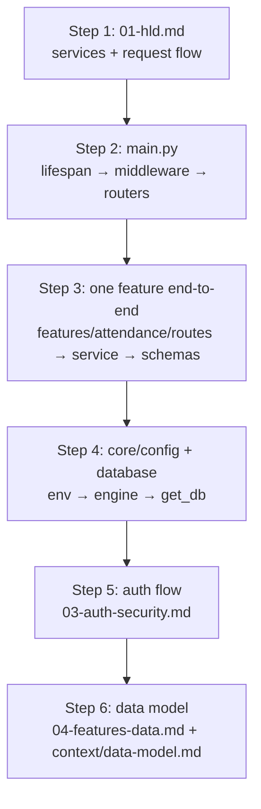
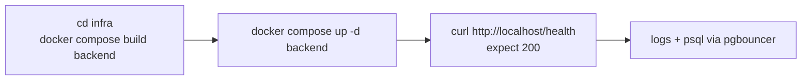
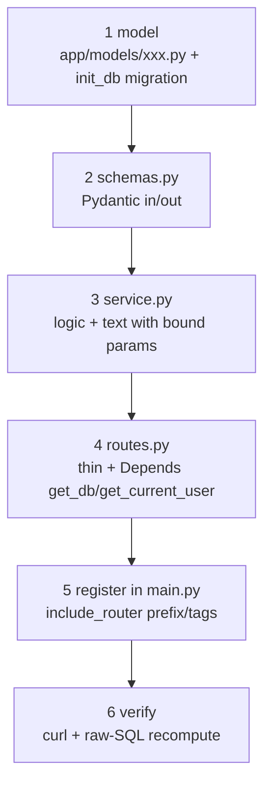

# 05 — Config, Codebase Guide, Runbook

Goal: read the codebase top-down, configure it, run it, and add a feature safely.

## 1. How to read the codebase (15-minute path)



| Step | Read | Look for |
|---|---|---|
| 1 | `infra/docker-compose.yml` + `infra/<svc>/docker-compose.yml` | Which containers exist, who talks to whom |
| 2 | `apps/backend/app/main.py` (215 lines) | Middleware order, router list — the full route table |
| 3 | `app/features/<one>/routes.py` → `service.py` → `schemas.py` | Thin-route pattern in practice |
| 4 | `app/core/config.py`, `app/core/database.py` | Every env var, pool choice, migration list |
| 5 | `app/features/auth/routes.py`, `services/session.py`, `app/utils/login_security.py` | Login/session/block behavior |
| 6 | `app/models/*.py`, `context/data-model.md` | Table + enum truth |

Never start by reading `utils/` alphabetically — always follow one request path first.

## 2. Configuration (`.env`)

Copy `apps/backend/.env.example` → `.env`. Precedence: **env vars > `.env` > defaults** (pydantic-settings).

| Group | Key vars | Notes |
|---|---|---|
| Keycloak | `KEYCLOAK_URL`, `REALM`, `KEYCLOAK_CLIENT_ID`, `KEYCLOAK_CLIENT_SECRET`, `EXTRA_REALMS` | Internal URL `http://keycloak:8080`. Multi-tenant via `EXTRA_REALMS` JSON. |
| Session | `SECRET_KEY` (required), `ALGORITHM`, `SESSION_EXPIRE_HOURS`, `SESSION_IDLE_TIMEOUT_MINUTES`, `SESSION_ACTIVITY_FLUSH_SECONDS` | Generate secret: `python -c "import secrets;print(secrets.token_hex(32))"` |
| URLs | `BACKEND_URL`, `FRONTEND_URL` (required), `PORTAL_URL`, `COMPANY_NAME` | CORS + reset links derive from these |
| Cookie | `COOKIE_SECURE` | `True` in production (HTTPS) |
| CORS | `CORS_ORIGINS` | JSON array or comma string |
| DB | `DATABASE_URL` (required, `postgresql+psycopg://…@pgbouncer:6432/…`), `DB_POOL_CLASS=null|queue`, `DB_POOL_SIZE`, `DB_MAX_OVERFLOW` | `null` behind pgbouncer; `queue` only for direct PG |
| Rate limit | `RATE_LIMIT_PER_SECOND` | Per-IP, per-worker memory (×4 effective) |
| Proxy | `FORWARDED_ALLOW_IPS` | Trust list for XFF; never `*` unless backend is proxy-only |
| Redmine | `REDMINE_URL`, `REDMINE_API_KEY` | Internal `http://redmine:3000` |
| MinIO | `MINIO_URL`, `MINIO_ACCESS_KEY`, `MINIO_SECRET_KEY`, `MINIO_BUCKET_NAME`, `MINIO_ASSETS_BUCKET` | `recordings`, `company-assets` |
| SMTP | `SMTP_HOST/PORT/USER/PASS/FROM`, `SMTP_ENABLED` | Gmail needs App Password |
| Reset | `RESET_TOKEN_EXPIRE_MINUTES` | 15 default |
| Turnstile | `TURNSTILE_SECRET_KEY`, `TURNSTILE_ENABLED` | Both required to enforce |
| Logs | `LOG_DIR` | Inside container |

Computed URLs (`config.py`): `JWKS_URL`, `ISSUER_URL`, `TOKEN_URL`, `LOGOUT_URL` from `KEYCLOAK_URL + REALM`.

## 3. Runbook



```bash
docker logs infra-backend-1 --since 10m 2>&1 | grep -iE "error|traceback"
docker logs infra-nginx-1 --since 10m 2>&1 | tail
psql -h 127.0.0.1 -p 6432 -U <user> -d <db>   # creds: infra/backend/.env DATABASE_URL
```

- Redmine UI: `http://localhost:3000` (tunnel `ssh -L 3000:localhost:3000 …`). Keycloak: `127.0.0.1:8080`.
- Login: `POST http://localhost/auth/login {"username","password"}` + `"realm":"vapt"` for VAPT.
- Verify analytics independently: fetch API JSON with session cookie → recompute from raw SQL (`psql`) → assert equality (members, totals, daily, streaks, monthly). Cover short range, prev month, full year, weekend/holiday shifts, 366-day cap. Never assert the code against itself.

## 4. Add a new feature (recipe)



Checklist: deterministic `ORDER BY` + tiebreak; batch with `ANY(:ids)`; `HTTPException` short detail; IST day boundaries; snake_case fields; stdlib → third-party → app imports; no new comments unless asked; no commit unless asked.

## 5. Gotchas (read before debugging)

1. Working days = shifts, not weekdays.
2. `EXTRACT(DOW)`: `0=Sun…6=Sat`; weekends `IN (0,6)` — `>=5` wrongly includes Friday.
3. Duplicate `shifts` rows → `COUNT(DISTINCT s.date)`.
4. Keycloak vs Redmine passwords drift; sync only via `/reset-password`.
5. Session limit 1 — many test logins as same user look like random logouts.
6. Rate limit keyed on real IP via proxy headers; backend proxy-only makes this safe.
7. In-memory limiter × 4 workers ≈ 4× limit.
8. pgbouncer transaction mode — no session state; pin IST timezone in SQL.
9. Analytics scope = active employees only.
10. `attendance.status` enum needs `SAEnum`.
11. Redmine users resolve by email — mismatched emails yield no projects.
